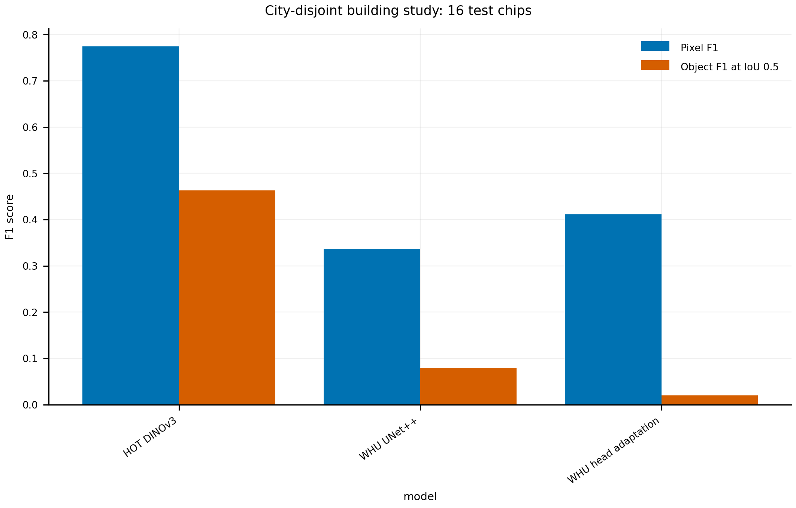
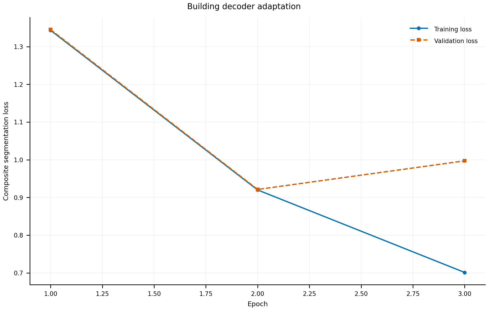

# Reproducible building model research

The workbench now imports a frozen study ZIP, trains local prediction heads or
both decoder and heads, installs a verified export, compares models, and renders
learning/comparison figures through the existing scientific studio. Training and
comparison run in the existing cancellable, project-scoped job system. Training
requires the operator administration token. Models are installed explicitly;
finishing a training job never replaces the extraction model automatically.

## Recorded study

The original PolyTopoBench/Inria image bytes and WKB annotations are pinned to
revision `91319835ea7fcbdad25105cbe90af58258259250`. Selection uses a fixed SHA-256
order, without consulting labels, and one patch per original source scene.

| Role | Cities | 512 × 512 chips |
| --- | --- | ---: |
| Training | Austin, Vienna | 48 |
| Validation | Chicago | 8 |
| Test | Kitsap, Tyrol West | 16 |

The frozen fingerprint is
`3562257ab197b1f9e6541515a96b48c6d0aafb4160c0063080120ad8cdb01bd4`.
[Source assignments and hashes](building-city-dataset.json) and
[recorded metrics, parameters and training history](building-city-study-results.json)
are checked in. The original patch files have no CRS; the research runner uses
pixel coordinates and does not invent georeferencing or geographic areas.

The comparison searches thresholds on validation pixel F1, then selects the
postprocessor on validation object F1. Model ranking uses validation pixel F1,
with object F1 as a tie-breaker. `selection.json` is written and hashed before the
first test prediction. Every jointly valid pixel is scored; objects use
maximum-cardinality one-to-one IoU matching, with a fixed nine-pixel minimum for
predictions. Separate supplied instance labels, including touching buildings,
are retained as the object reference. Without them, the report explicitly marks
connected semantic labels as a proxy rather than true instances.

| Candidate | Test building pixel F1 | Test IoU | Test object F1, IoU ≥ 0.5 |
| --- | ---: | ---: | ---: |
| HOT DINOv3, validation-selected | 0.7744 | 0.6319 | 0.4629 |
| WHU UNet++ baseline | 0.3366 | 0.2024 | 0.0800 |
| WHU UNet++ head adaptation | 0.4113 | 0.2589 | 0.0198 |



The 16 test chips contain 4,194,304 scored pixels and 83 labeled objects. These
are limited public-data observations, not a universal accuracy qualification.
The publisher removed empty patches from its training pool, which affects source
availability. Geographic separation is enforced for this study; all upstream
candidate pretraining corpora have not been independently audited. Do not equate
this score with the previous HOT smoke benchmark on a different dataset.

A secondary diagnostic uses the old fixed HOT operating point (threshold 0.5,
connected regions) on the same test images: pixel F1 **0.7695**, object F1
**0.5510**. Its higher object F1 exposes a failed generalization of the new
validation-selected watershed configuration. The primary receipt remains intact;
test data was not used to choose replacement parameters. Connected regions
remain the default in both API and UI. Watershed is an explicit experimental
option, not an asserted accuracy improvement. The head-adapted model produces
many false split instances and is not promoted over HOT.

Two real CPU adaptation runs were completed, using training and validation only:

| Adaptation | Trainable parameters | Epochs / selected | Validation loss before → selected |
| --- | ---: | ---: | ---: |
| Prediction heads | 435 | 12 / 12 | 2.4964 → 1.2032 |
| Decoder and heads | 3,264,787 | 3 / 2 | 2.5150 → 0.9213 |

The encoder is frozen; head mode also freezes the decoder. Batch normalization
and dropout remain in evaluation mode. Loss combines foreground BCE and Dice,
boundary BCE and signed-distance Smooth L1. Train-only class weighting,
deterministic seeds, source/model hashes, epoch history and exported checkpoint
hashes are recorded. The decoder run followed inspection of the primary report;
it receives only a subsequent validation-only comparison, not another claimed
untouched test score. Loss reduction alone does not demonstrate test accuracy.



## Reproduce locally

In the existing GeoFathom Python environment, install a matching PyTorch build
for the intended CPU/CUDA host, then install the optional dependencies:

```powershell
python -m pip install -e ".[vision,building-training,building-study]"
python -m vision.provision
python -m vision.provision --model whu-unetplusplus-efficientnet-b4
python scripts/prepare_building_study.py --output data/building-city-study
python scripts/building_research.py train --dataset data/building-city-study/dataset.json --output data/building-city-adaptation --epochs 12 --install-as city-adapted-unetplusplus
python scripts/building_research.py compare --dataset data/building-city-study/dataset.json --models hotosm-dinov3s-buildings whu-unetplusplus-efficientnet-b4 city-adapted-unetplusplus --output data/building-city-comparison
```

Use fresh output directories. Preparation requires network access; training and
comparison do not. On Linux, `--offline` uses the existing libseccomp runner to
deny network syscalls throughout the numerical process. For decoder adaptation,
add `--mode decoder --epochs 3 --learning-rate 0.0001 --batch-size 1` to a new
training run. Add `--validation-only` to comparison during development; the UI
also defaults to validation-only. Repeated test evaluations remain possible but
must not be described as new independent qualification.

To restore an extracted training bundle without redownloading or retraining:

```powershell
python -m vision.provision --from-training path/to/extracted/head --model city-adapted-unetplusplus
```

Each training directory contains `model.onnx`, tensor-only `model.safetensors`,
`model.json`, and `training.json`. Installation verifies both model hashes and
publishes the manifest last; existing IDs are never overwritten. Candidate
architectures come from a closed local registry, not executable user code.

The browser accepts a ZIP with `dataset.json` at its root and all declared
relative image/label/optional instance files. The importer verifies every hash,
grid alignment, duplicate image, cross-split region and source group, archive
paths and size limits. Schema examples are in `building-city-dataset.json`.
Import through **Raster / AI → AI building footprint extraction → Model
training and validation**. Completed research jobs offer a reproduction ZIP and
**Open building research figures** with the actual history or comparison table.

## Instance outputs and GPU acceptance

Experimental watershed combines geometric distance, declared learned signed
distance and boundary heads. Component processing spans inference tile seams;
foreground support and courtyard holes are preserved. It can oversegment and
requires review. Exports include `instances.tif` and, when supplied by the model,
`boundary.tif` and `distance.tif`, along with the existing mask/probability,
GeoJSON/CSV and measurement outputs. Int32 IDs retain more than 255 instances.
Component memory and total instance limits are enforced before large allocations.

The current host has no CUDA execution provider. GPU acceptance is explicitly
**unavailable**, not passed. On the RTX 4070 Ti Super host, run:

```powershell
python scripts/building_gpu_acceptance.py --model hotosm-dinov3s-buildings --sample path/to/rgb.tif --output data/building-gpu-acceptance.json --repeats 5
```

The script profiles actual ONNX CUDA node execution, rejects unexpected CPU
numerical fallbacks, checks CPU/CUDA head errors, valid masks, binary agreement
and per-instance IoU ≥ 0.99, and records median tile time plus device-wide VRAM
snapshots. Snapshots are instantaneous and are not per-process peak memory.
CPU fallback exits unsuccessfully and cannot qualify a GPU run.

## Sources

- [PolyTopoBench dataset](https://huggingface.co/datasets/PingL/PolyTopoBench),
  original Inria imagery, Maggiori et al. (2017); PolyTopoBench curation, Liu et al.
  (2026); vector labels, OpenStreetMap contributors, ODbL-1.0. Retain the source
  dataset usage terms and attribution when sharing patches.
- [WHU author model](https://huggingface.co/giswqs/whu-building-unetplusplus-efficientnet-b4),
  revision `09df9efd323bbd3d56b98b4857129eb9b5baa2d3`. The conversion uses the
  exact foreground-minus-background logit margin and the author's divide-by-255
  preprocessing. Initial auxiliary heads are disabled until adaptation.
- [HOT DINOv3 source and prior integration acceptance](BUILDING_EXTRACTION.md).

## Precision-focused experiments

The current comparison searches the three best validation pixel thresholds plus
the fixed 0.5 operating point jointly with connected regions and four watershed
seed distances. It maximizes the harmonic mean of equally weighted regional
pixel and object F1, subject to a 0.03 pooled pixel-F1 loss guard within each
model. The evaluation now uses the same component-local watershed normalization
as deployment. Historical reports above remain unchanged and are not comparable
without recording the different selection protocol. For four-view fusion, run a
separate validation-only comparison with `--augmentation flips`. Inference
averages spatially restored probability, boundary and signed-distance heads;
no source resampling is performed. It uses four sequential model passes per
tile and is experimental until independent data demonstrate an improvement.

Enhanced training is opt-in in the research panel or via `--enhanced-training`.
Seeded paired flips preserve every target head, decoder RGB receives bounded
brightness/contrast jitter, and cosine learning-rate decay and early stopping
use validation loss. The initial checkpoint remains eligible and validation
and test images are never augmented for training. Use a fresh output directory.

### Probability reliability

Model comparison fits a bounded temperature grid by pooled validation negative
log likelihood. A frozen selection receipt binds the temperature before any
test image is scored. Raw and temperature-scaled reliability diagrams, pooled
ECE, Brier score, NLL, and selective-error/coverage statistics are reported
separately for validation and held-out data. Empty or single-class validation
support cannot qualify calibration. Scaling does not change the extraction mask,
geometry, or raw operating threshold; the deployed model remains explicitly
uncalibrated until a matching calibration artifact is independently qualified.

Building footprints now use a conservative pixel-grid outline guard. Candidate
simplification must keep component and hole counts, add no measurable outward
area, change at most 0.25 source pixel and 0.5% area, and rasterize to identical
pixel centers. Otherwise the original boundary is retained. A bounded window
prevents unbounded rasterization. The raw inference mask remains authoritative;
this is not a claim of subpixel ground truth. Instance boundary F1 additionally
measures shared walls between adjacent labeled buildings, distinct from binary
foreground boundary F1.

The research panel now exposes object F1 at IoU 0.75, shared-wall boundary F1,
and raw versus temperature-scaled ECE/Brier/NLL from the corresponding study
split. The downloaded research bundle retains complete reliability bins and
coverage/error curves. CPU/CUDA partition acceptance uses the same local
component processing as the deployed raster path. Enhanced training and fused
inference remain opt-in until independent accuracy is demonstrated.

### Multi-scale inference

The experimental multi-scale mode evaluates native context and centered 1.25x
and 1.5x magnifications. Each probability field is inverse-mapped by pixel
center and tapered near its crop edge before fusion; native probabilities are
always retained. Boundary and distance heads remain native-scale. Output CRS,
validity mask and cell size do not change. Magnification does not recover missing
source resolution. Use `--augmentation multiscale` for a separate frozen
comparison. Three sequential model passes per tile are recorded and bounded.

### Paired independent-test qualification

Each model's selected candidate is compared against the same model at the fixed
native 0.5 connected baseline on the exact same holdout chips. Both settings and
the policy are frozen before test prediction. The gate requires independent
instance labels, at least two regions and ten distinct source groups per region,
object F1 improvement of at least 0.01, at most 0.01 pooled pixel/object@0.75 F1
loss, at most 0.05 regional object F1 loss, and a positive lower endpoint of a
paired 1000-draw source-group bootstrap interval for object F1 gain. A small
or reused holdout cannot establish new blind qualification: the numerical gate
is conditional on supplied regions, not an assertion that pretraining or prior
experiments were independent. Neither the gate nor a successful comparison
automatically installs or promotes any model.

AOI extraction is source-tile anchored. Selecting an irregular or offset study
area clips only the retained output pixels; source context, tile origin, RGB
normalization and binary head decoding are shared with full-scene comparison.
The same valid source pixel must have the same probability under identical
model/inference settings, regardless of AOI. Component partitions can still
change if an AOI cuts a building; this is not an instance identity guarantee.

### Hard-example training objective

The opt-in `--objective hard_examples` combines class-weighted BCE, per-chip
top-quartile hard-pixel loss, per-chip Dice, bounded interior-width weighting,
class-balanced boundary BCE and foreground-weighted distance loss. It retains
supervision on every pixel and all three heads. The distance target is a
narrow-structure proxy, not an independent building-size measurement. The
initial checkpoint and trained checkpoints use the same chosen validation
objective; loss values cannot be compared across different objectives. Test
regions remain untouched during checkpoint selection. This objective is
experimental until independent imagery demonstrates an improvement.
