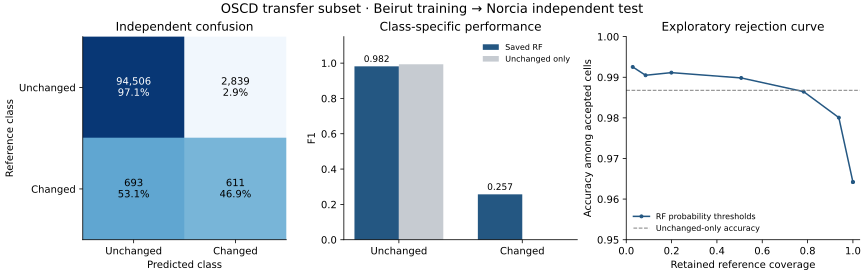

# Observed remote-sensing acceptance evidence

The committed observations were generated from the implemented research branch.
Each JSON records actual results, hashes, parameters and a limited scope. Tests
passing establishes computational acceptance, not a scientific maturity score.

| Evidence | Actual observation | Scope |
| --- | --- | --- |
| [OSCD annotation transfer](oscd-observed.json) | 4,959 training samples in Beirut (137 changed), 98,649 independent test cells in Norcia; accuracy 0.964196, macro F1 0.619351, mIoU 0.555725 | Fixed two-city subset of the author's training/test split; six registered raw L1C DN features; not full-dataset leaderboard performance |
| OSCD change class | Precision 0.177101, recall 0.468558, F1 0.257047 | The unchanged-only baseline reaches accuracy 0.986781 and change F1 0. Overall accuracy hides rare-class weakness; transfer remains a scientific limitation |
| [Author-scene native arithmetic](native-observed.json) | 262,144 real native-grid cells; exact independent DN difference and mask agreement | Pinned author-published Sentinel-2 data; no physical-reflectance inference |
| [Six-date L2A pipeline](stac-observed.json) | Six Sentinel-2A Collection-1 L2A acquisitions, explicit STAC scale 0.0001 and offset −0.1, original 20 m SCL screening, 10 m cube; 10,146 trend cells; maximum independent least-squares difference 1.12757×10⁻¹⁷ | Actual calibrated product processing, NDVI arithmetic and UTC day-axis integration; no field vegetation/reflectance accuracy claim |
| [Scene-scale CPU test](scene-scale-observed.json) | 4096×4096 pixels; 15,153,614 retained observations; exact mask/arithmetic agreement for 128/512 windows; observed peak RSS 163.6/187.2 MiB and 3.19/2.42 s | Structured synthetic input with invalid values deliberately confined to excluded QA pixels; observed environment-specific CPU performance |

OSCD's TIFF and rectified band files require care: rectified arrays have no
georeferencing. The benchmark proves the first rectified red array equals its
original georeferenced red band, then uses that authoritative geometry. Numeric
features are bilinearly projected to a declared 10 m UTM grid and labels use
nearest neighbor. Actual TIFF codes 1/2 are verified pixel by pixel against the
provided PNG unchanged/change legend 0/255, rather than assuming the README's
0/1 TIFF description. Calibration is never guessed from L1C filenames.



The [pinned OSCD manifest](oscd-manifest.json) retains official mirror URLs,
member byte ranges, CRCs, SHA-256 hashes, selected cities and sampling/model
parameters. Only required archive members are fetched. Data remain subject to
the author's attribution and noncommercial/share-alike label terms; full data
are not redistributed in this repository. Author source:
<https://rcdaudt.github.io/oscd/>. Citation: Daudt et al. (2018), *Urban Change
Detection for Multispectral Earth Observation Using Convolutional Neural
Networks*, IGARSS, pp. 2115–2118.

Rerun in a fresh work directory with the locked environment:

```bash
python scripts/remote_oscd_benchmark.py --cache build/oscd-cache --work build/oscd-work --output build/remote-oscd-reference.json
python scripts/remote_scene_reference.py --oscd-native build/oscd-cache --output build/remote-scene-reference.json
python scripts/remote_stac_pipeline.py --cache build/stac-cache --work build/stac-work --output build/remote-stac-reference.json
python scripts/remote_scene_scale.py --work build/scene-scale --output build/remote-scene-scale.json
```

Input hashes, the code version and numeric package versions belong with every
new observation. Restore the original inputs and environment for bitwise model
repetition. OSCD spatial percentile intervals assume exchangeable 100 m sampled
blocks; contiguous pixels and label interpretation can still be correlated.
L2A product calibration does not supply independent field truth. Threshold
curves are exploratory if the same reference chooses a rejection policy.

The automated native-DN check uses the same pinned author-published OSCD
scene as annotation validation. The older Zenodo native fixture remains an
explicit standalone option; its server returned HTTP 403 to GitHub runners.
Changing the declared data source preserves the native arithmetic/mask oracle
and checksum requirements, rather than treating an inaccessible download as
scientific success.
